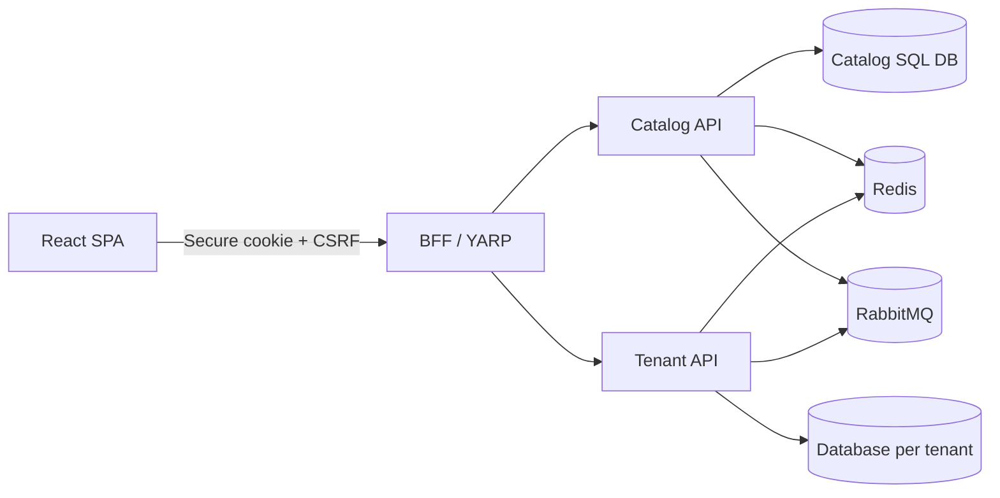
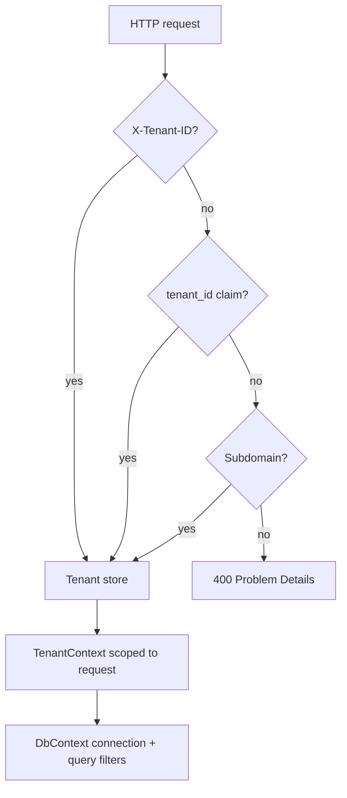

# Enterprise SaaS Starter Platform

A local-first, cloud-ready multi-tenant SaaS foundation using .NET 10, C# 14, SQL Server, Redis, RabbitMQ, a secure BFF, and React. The code is split into Domain, Application, Infrastructure, and Presentation boundaries and treats tenant isolation as a platform invariant.

This is an architecture foundation, not a production-ready product. Tenant isolation primitives are implemented; identity-provider login, broker processing, migrations, tenant provisioning automation, and live integration coverage remain explicit gaps. See [capability maturity](docs/architecture.md) and [verification scope](docs/verification.md).

## What is implemented

- Catalog and tenant bounded contexts with CQRS handlers and repositories
- Database-per-tenant connection selection, ordered tenant resolution (`X-Tenant-ID`, JWT claim, subdomain), global query filters, and cross-tenant write guards
- JWT creation, refresh-token model, OAuth provider abstraction, role/permission policy primitives, secure BFF cookies, antiforgery validation, and YARP forwarding
- Distributed cache abstraction and tenant-safe keys; boolean, tenant, user, percentage, and time-window feature evaluation
- Database localization abstraction, dynamic form models and JSON Schema generation, structured audit records
- Domain/integration events plus transactional outbox/inbox persistence models
- Problem Details, structured Serilog request logs, HTTPS, CORS, and fixed-window rate limiting
- SQL Server, Redis, and RabbitMQ local infrastructure; unit, integration scaffold, and architecture tests

## Architecture





Dependencies point inward: API → Application → Domain, while Infrastructure implements Domain/Application ports. Domain projects reference only `SharedKernel`.

## Run locally

Requirements: .NET SDK 10, Node 24+, Docker Desktop.

```powershell
Copy-Item .env.example .env
# Replace both example secrets before use.
docker compose up -d
dotnet build EnterpriseSaaS.slnx
dotnet test EnterpriseSaaS.slnx --no-build
cd src/Web
npm install
npm run dev
```

Run the APIs in separate terminals with `dotnet watch --project src/Catalog.Api`, `src/Tenant.Api`, and `src/Bff`. OpenAPI documents are exposed as `/openapi/v1.json` in Development. RabbitMQ management is at `http://localhost:15672`.

Apply `scripts/init.sql`, create EF migrations for both contexts, and seed an active Catalog tenant whose connection string points at `SaaS_Tenant_demo`. Automatic migration execution should be enabled only for local Development; production-style environments should use reviewed migration bundles.

## Security notes

Credentials are not committed. Use environment variables or a local secret store, and never place tenant connection strings in request data. The BFF owns browser cookies and CSRF; access tokens should stay server-side. The included configuration-backed tenant directory is for local development and should be replaced by a protected directory and secret-broker adapter in production.

## Verification

`dotnet build EnterpriseSaaS.slnx` and `dotnet test EnterpriseSaaS.slnx` are the baseline. Live integration tests require Docker infrastructure and should be explicitly enabled with `RUN_INTEGRATION_TESTS=true` once migrations are generated.
