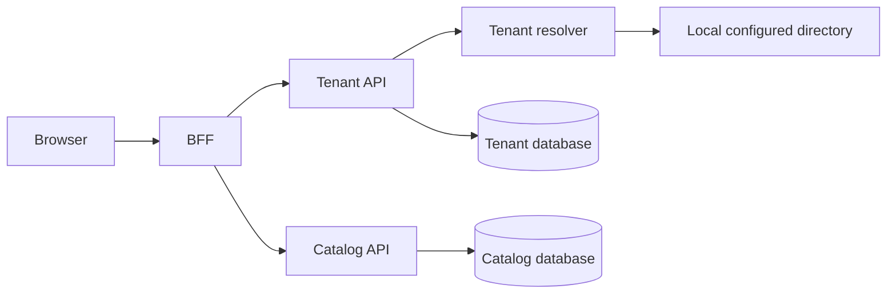

# Architecture

## Capability maturity

| Capability | Maturity | Evidence and gap |
| --- | --- | --- |
| Tenant resolution | Reference implementation | Header, claim, and subdomain resolution with a configuration-backed local directory. A production tenant-directory service is not implemented. |
| Tenant isolation | Implemented core | Scoped tenant context, global query filters, and cross-tenant write guards; adversarial integration coverage is still required. |
| Catalog provisioning | Development scaffold | Endpoints are mapped only in Development and currently accept connection strings directly. |
| Authentication/BFF | Building blocks | JWT creation and secure-cookie/CSRF primitives exist; no login or identity-provider flow is wired end to end. |
| Messaging | Contracts and persistence models | Broker publisher/consumer and outbox dispatch are not wired. |
| Database lifecycle | Schema models | Reviewed EF migrations and tenant provisioning automation are not included. |

The local configuration store is a replaceable adapter. A production design should resolve an opaque tenant identifier through a protected directory, return a secret reference rather than a raw connection string, and obtain short-lived credentials from a secret broker.
